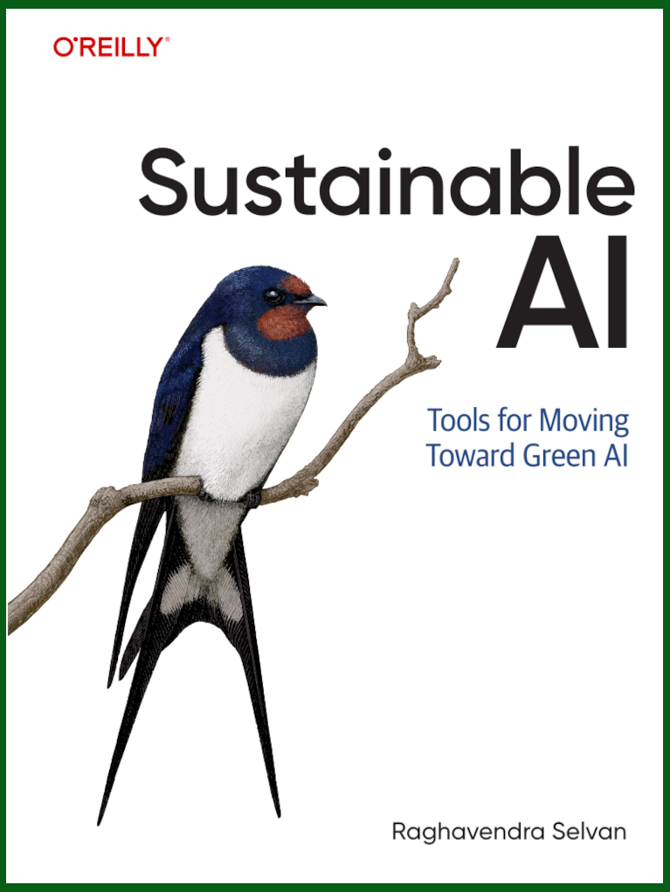

Raghavendra Selvan (Raghav) is a Tenure-Track Assistant Professor at the Machine Learning (ML) Section, Department of Computer Science, University of Copenhagen. His research spans efficient ML, ML for sciences, medical image analysis, and graph neural networks. He holds a PhD from the University of Copenhagen and is affiliated with Pioneer Center for AI (Denmark) and the pan-European AI network ELLIS. Raghav was born in Bangalore, India. RS is the author of the new book "[Sustainable AI](https://raghavian.github.io/sustainable-ai/)".

## Book Available Now! 

[{: .align-center style="width: 200px;"}](https://raghavian.github.io/sustainable-ai/)

RS has published _Sustainable AI_, a book that maps the socio-technical aspects of the interplay between sustainability and AI. Check out the webpage for the book [here.](https://raghavian.github.io/sustainable-ai/)

## Hiring

If you are interested in joining our team check out the open positions advertised on [UCPH Job Portal](https://employment.ku.dk/). Note that, we are _not_ offering online-only opportunities or funded internships from our group. See grants offered by the likes of [DDSA](https://ddsa.dk/visitgrant/) for funding opportunities and if it is applicable to you.

<!-- 
## Events

And if no positions are currently being advertised by me, feel free to reach out with a short email about what you are interested in and how the [projects](https://saintslab.github.io/projects/) in my team might be of interest to you. The latter also holds for visiting researchers, and prospective thesis students (enrolled at UCPH). 
We are organizing the first P1 Program on Green AI Workshop on 8 May, 2026. See program and sign up [here](https://di.ku.dk/english/events/event-calendar-2026/green-ai-workshop/).

**Current openings**: 
* PhD Position on Sustainable AI and Resource Efficient Machine Learning at Linkoping University with Sebastian Mair, that RS will co-supervise. (deadline 24th April, 2026, [details](https://liu.se/en/work-at-liu/vacancies/28717))
-->

## News
* 2026-10: RS will serve as Action Editor for [TMLR](https://jmlr.org/tmlr/)
* 2026-09: [Bakhtiarifard et al.](https://arxiv.org/abs/2605.15551), "Characterizing Learning in Deep Neural Networks using Tractable Algorithmic Complexity Analysis" accepted to NeurIPS.
* 2026-09: [Chen & Selvan](https://arxiv.org/abs/2509.10367), "A Discrepancy-Based Perspective on Dataset Condensation" accepted to TMLR with Survey certification.
* 2026-08: RS has been awarded the [HC Ørestad Research Talent Prize](https://hcoersted.dk/portfolio-item/raghavendra-selvan-h-c-orsted-forskertalentprisen-2026/) for 2026.
* 2026-07: [Johansen et al.](https://doi.org/10.1039/D6DD00088F), "Tackling Real-World Crystal Structure Prediction from Powder X-ray Diffraction Data" accepted to Digital Discovery.
* 2026-07: RS has been awarded Sapere Aude: DFF Research Leader grant for the new project [CITADL](https://dff.dk/en/our-funded-projects/meet-the-researchers/research-leaders/eksterne-personer-en/research-leaders-2026/raghavendra-selvan/)
* 2026-07: Inie et al., "The CO2ST of Agentic AI in Research" accepted to the Nordic Conference on Human-Computer Interaction (NordCHI).
* 2026-06: RS has an invited comment article at The Lancet Digital Health: [Selvan (2026)](https://www.thelancet.com/journals/landig/article/PIIS2589-7500(26)00039-7/fulltext)
* 2026-05: [Bakhtiarifard et al.](https://arxiv.org/abs/2502.20016), "Position: Neglecting the Sustainability of AI is fuelling a Global AI Arms Race" accepted to be presented at ICML, 2026.
* 2026-05: [Wilson et al.](https://arxiv.org/abs/2602.19789), "Position: Stop Preaching and Start Practising Data Frugality for Responsible Development of AI" accepted to be presented at ICML, 2026. 
* 2026-04: [Wilson et al.](https://arxiv.org/abs/2602.00056), "How Hyper-Datafication Impacts the Sustainability Costs in Frontier AI" accepted to be presented at ACM FAccT, 2026. 
* 2026-04: [Johansen et al.](https://openreview.net/forum?id=LftFQ35l47), "deCIFer: Crystal Structure Prediction from Powder Diffraction Data using Autoregressive Language Models" accepted to TMLR.
* 2026-02: Saints Lab is organizing SAINTS'26 on 6 March, 2026. See program and sign up [here](https://saintslab.github.io/workshop2026/).
* 2026-01: [Comment article](https://www.nature.com/articles/s41581-026-01047-3) published accepted at Nature Reviews Nephrology. 
* 2025-12: [Wenshøj et al.](https://openreview.net/forum?id=bPwcJ0nkDC), "Oscillations Make Neural Networks Robust to Quantization" accepted to TMLR.
* 2025-11: Sustainable AI now published, and available [online](https://raghavian.github.io/sustainable-ai/).

[News archive](/news-archive/)

<!--
Research Projects
======
*(Switching to first person :)*

I am actively involved in a wide range of research projects as part of my roles at the Machine Learning section and Data Science Lab of University of Copenhagen. Brief descriptions of ongoing and completed projects are listed below.

Ongoing projects 
---
* **Resource Efficient Machine Learning**:
Making ML more efficient in terms of compute, energy consumption, training data and labels can impact their global adoption, while improving their overall environmental sustainability. Funded by two EU Horizon 2020 projects, we will explore these themes further in our new work. Results from our earlier work show some promising results in these directions. For instance, we introduced [tensor networks for medical image classification](https://raghavian.github.io/publication/2020-01-01-Tensor-Networks-for-Medical-Image-Classification) tasks that require less than 10% of GPU resources when compared to traditional deep learning models. We have also put out a tool -- [Carbontracker](https://arxiv.org/abs/2007.03051) -- to predict and track carbon footprint of developing deep learning models, in an effort to encourage research into energy-efficient models which is [used widely](https://pepy.tech/project/carbontracker) by the community.

* **AIChemy: Generative Modelling of nanoparticles**: 
Obtaining structures from scattering data for nanomolecules turns out to be an expensive and difficult task. This ongoing collaboration with [Prof. Kirsten Jensen’s group](https://chem.ku.dk/ansatte/alle/?pure=en/persons/540779) we are explorting generating valid nanomolecular structures from x-ray scattering data using deep generative models with [promising early results](https://raghavian.github.io/publication/2020-07-characterisingAtomicStrucs).

* **Locomotion analysis**:
In this collabortion with [Kiehn Lab](https://in.ku.dk/research/ole-kiehn/), my role has been to analyze videos of mice running on treadmills in order to extract speed, cadence and coordination statistics. The results from analyzing some 1000 videos have accentuated the role of [specific interneurons in the spinal cord that influence locomotion](https://raghavian.github.io/publication/2020-01-01-Locomotor-deficits-in-ALS-mice-are-paralleled-by-loss-of-V1-interneuron-connections-onto-fast-motor-neurons).

* **Sustainable neuroimaging**:
As the Chair of the SEA-SIG [Neuroimaging Research Working Group](https://neuropipelines.github.io/), a team within SEA-SIG, I am leading an international team of 15 colleagues. This volunteer team is dedicated to the carbon footprinting of neuroimaging pipelines, and generation of best practice guidance. 

* **Quantifying insect biodiversity**: In this ongoing collaboration with [FaunaPhotonics](https://www.faunaphotonics.com/), we are attempting unsupervised clustering of insects based on optically recorded signals from field data. An [initial attempt](https://arxiv.org/abs/2102.05526) involved using a variational autoencoder that dynamically adjusts the tradeoff between reconstruction and regularisation terms.

* **Uncertainty Quantification**:
Medical image segmentation with well calibrated and meaningful uncertainty estimation can be more useful in clinical settings. For example, we present a [probabilistic segmentation model](https://raghavian.github.io/publication/2020-07-uqFlow) that uses normalizing flows to improve the diversity of segmented samples.

Completed projects
---
*  **COVID-19 Risk Modelling** (2020-2021): Collaboration with hospitals in Zealand region of DK. [pub1](https://raghavian.github.io/publication/2020-10-COVID) [pub2](https://raghavian.github.io/publication/2020-01-01-Lung-Segmentation-from-Chest-X-rays-using-Variational-Data-Imputation)
* **Behavioural analysis of narwhals** (2021): [Collaboration as part of Data Science Lab](https://arxiv.org/abs/2101.01992)
* **Segmentation of roots in soil** (2019): [Collaboration with Plant & Environ. Science Dept.](https://raghavian.github.io/publication/2019-01-01-Segmentation-of-roots-in-soil-with-U-Net)
* **Extraction of airways from volumetric data** (2018): [PhD Thesis](https://raghavian.github.io/publication/2018-01-01-Extraction-of-Airways)
* **Bayesian tracking of multiple point targets** (2015): [MSc Thesis](https://raghavian.github.io/publication/2015-01-01-Bayesian-tracking-EM)
* **India's first pico-satellite** (2010): [Collaboration with Indian Space Research Organisation](https://earth.esa.int/web/eoportal/satellite-missions/s/studsat-1)

<!-- * **COVID-19 Risk Modelling**: 
#As part of a collaboration with the hospitals in Zealand region of Denmark, we are modelling COVID-19 risk from [clinical](https://raghavian.github.io/publication/2020-10-COVID) and image data. I am contributing to the team focusing on [using chest X-rays](https://raghavian.github.io/publication/2020-01-01-Lung-Segmentation-from-Chest-X-rays-using-Variational-Data-Imputation) at admission to model risk of COVID-19.
-->
